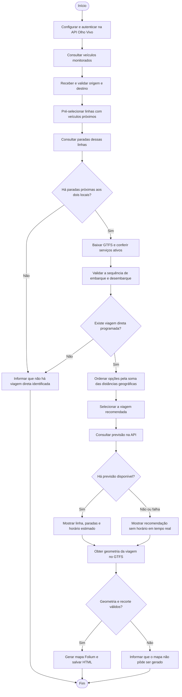

# Fluxograma — Recomendação de transporte público

O diagrama abaixo resume as etapas efetivamente implementadas no notebook principal.

**Observações:** a soma das distâncias até as paradas usa medidas em linha reta; não calcula caminhos reais de pedestres. A pré-seleção por posição dos veículos limita a busca e pode deixar de considerar algumas linhas. A previsão de chegada pode não estar disponível, mas isso não impede a apresentação da recomendação programada.
